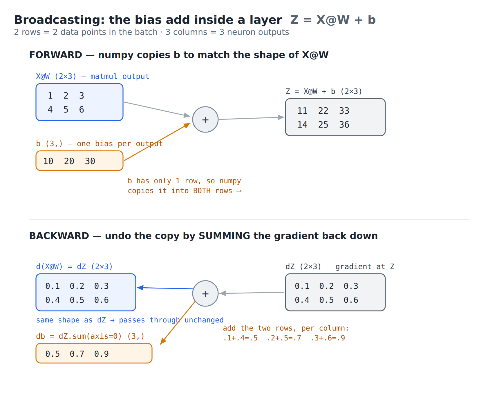

# Build a Vectorized Autograd Engine — guided capstone

**What you'll build:** the same reverse-mode autodiff as the scalar `micrograd`, but on
**numpy arrays** — a `Tensor` that differentiates array operations, including the two that
matter most in ML: **matrix multiply** and **broadcasting**. Then you'll train an MLP where
each layer is a single `X @ W + b` over the whole dataset at once, and watch it finish in a
fraction of a second.

**Prerequisites:** the scalar autograd capstone (`micrograd-from-scratch`) — you'll reuse its
graph/backward structure and its Stage-5 ML ideas (hinge loss, ±1 labels, L2, two-moons),
which are recapped where they come up here — plus two things from the matrix-calculus module:
- the **chain-rule / Jacobian identities**: for `Z = X @ W`, `dX = dZ @ Wᵀ` and `dW = Xᵀ @ dZ`
  (re-derived in Stage 2);
- the **layout / transpose** rule — which transpose goes where is decided by making the matrix
  shapes meet. That rule *is* the matmul backward.

**What's genuinely new vs the scalar engine:** only two ideas — a **broadcasting-aware
backward** (Stage 1) and the **matmul backward** (Stage 2). Everything else (the graph, the
reverse-topological sweep, activations, `backward()`) is the micrograd structure you already
built, lifted from scalars to arrays.

**How the stages are graded (read once):**
- `vectorgrad/engine.py` and `vectorgrad/nn.py` are **stubs you fill in**, checked by `pytest`.
  The suite starts all-red; turn it green stage by stage.
- `train.py` is **also a stub, but no test runs it.** It's the capstone demo you write in
  Stages 5–6, then run yourself with `python train.py`. The tests check your engine and `nn`
  library; `train.py` is how *you* watch the whole thing learn and time it.
- `data.py` and everything in `tests/` are **already written** — you never edit them.

**How to work each stage:** read the **concept**, attempt the **your task**, then expand the
collapsible **reference implementation** to check yourself, and run the **checkpoint**. Write
your own version first; `SOLUTION/` has the full reference.

---

## Stage 0 — Setup

```bash
python -m venv .venv && source .venv/bin/activate   # Windows: .venv\Scripts\activate
pip install -r requirements.txt
pytest -q                                            # fails — your to-do list
```

---

## Stage 1 — The `Tensor` node, and broadcasting backward

**Concept.**

*The graph.* A `Tensor` wraps a numpy array and, like `Value`, records **who made it** — its
inputs and the op that produced it. Building an expression builds a graph; `backward()` walks it
in reverse, handing each node its gradient. Same idea as micrograd, just arrays instead of
scalars.

*What broadcasting is.* When you do math on two arrays whose shapes **don't match**, numpy
automatically **stretches the smaller one — copying its values — until the shapes line up**,
then does the operation elementwise. That copying is called **broadcasting**. The place it
happens in a network is the **bias add inside a layer**: a layer computes `X @ W + b`, where
`X @ W` is a batch of shape `(N, nout)` (one row per data point) and the bias `b` is just
`(nout,)` — so `b` has to be copied onto all `N` rows before the `+`. Worked small example
(`N = 2` points, `nout = 3` outputs):

```
X@W = [[1, 2, 3],     (2, 3)        b = [10, 20, 30]   (3,)
       [4, 5, 6]]

b is copied down to both rows →  [[10, 20, 30],
                                  [10, 20, 30]]

Z = X@W + b = [[11, 22, 33],
               [14, 25, 36]]        (2, 3)
```

"**Silently**" just means numpy does that copy for you — there's no loop in your code, no
message, no warning; you type `X@W + b` and it works. Easy to forget it happened — which
matters, because backward has to *undo* it.

*The one new rule — forward copies ⇒ backward sums.* Focus on a single bias number, say
`b₀ = 10`. It was copied into **2 positions** (one per row), so it influenced the loss through
**2 paths**. The multivariable chain rule says: when a value feeds the output through several
paths, its gradient is the **sum** over those paths. So with an upstream gradient `dZ` arriving
at `Z`:

```
dZ = [[0.1, 0.2, 0.3],       db₀ = dZ[0,0] + dZ[1,0] = 0.1 + 0.4 = 0.5
      [0.4, 0.5, 0.6]]        db₁ = 0.2 + 0.5 = 0.7
                              db₂ = 0.3 + 0.6 = 0.9
db = dZ.sum(axis=0) = [0.5, 0.7, 0.9]        (3,)
```

Forward **copied** `b` down the rows; backward **sums** `dZ` back down the same rows — mirror
operations. (`X@W`, which already matches `Z`'s shape, isn't copied, so its gradient passes
straight through: `d(X@W) = dZ`.) The picture:



*What `_unbroadcast` does.* It takes a gradient that's the *output's* shape and **sums it back
down to the input's original shape**, reversing the copy. Two cases: (1) an input that gained a
leading axis (like `b (3,)` → `(2,3)`) — sum that axis off; (2) an input with a size-1 axis that
got stretched (like `(1,3)` → `(2,3)`) — sum that axis but keep it size-1 so the shape still
lines up. That's the whole helper.

**Your task.** Implement `__init__`, `_unbroadcast`, `__add__`, `__mul__`.

<details>
<summary>Reference implementation — try the task first, then expand</summary>

```python
import numpy as np

class Tensor:
    def __init__(self, data, _children=(), _op=''):
        self.data = np.asarray(data, dtype=np.float64)
        self.grad = np.zeros_like(self.data)
        self._backward = lambda: None
        self._prev = set(_children)
        self._op = _op

    @staticmethod
    def _unbroadcast(grad, shape):
        # reverse numpy broadcasting: collapse grad back to `shape`
        while grad.ndim > len(shape):           # extra leading axes -> sum them off
            grad = grad.sum(axis=0)
        for i, s in enumerate(shape):           # axes that were size-1 -> sum, keepdim
            if s == 1:
                grad = grad.sum(axis=i, keepdims=True)
        return grad

    def __add__(self, other):
        other = other if isinstance(other, Tensor) else Tensor(other)
        out = Tensor(self.data + other.data, (self, other), '+')
        def _backward():
            self.grad  = self.grad  + Tensor._unbroadcast(out.grad, self.data.shape)
            other.grad = other.grad + Tensor._unbroadcast(out.grad, other.data.shape)
        out._backward = _backward
        return out

    def __mul__(self, other):
        other = other if isinstance(other, Tensor) else Tensor(other)
        out = Tensor(self.data * other.data, (self, other), '*')
        def _backward():
            self.grad  = self.grad  + Tensor._unbroadcast(other.data * out.grad, self.data.shape)
            other.grad = other.grad + Tensor._unbroadcast(self.data  * out.grad, other.data.shape)
        out._backward = _backward
        return out
```

</details>

**Checkpoint.** These tests actually *run* your `_backward` closures (by setting `out.grad` and
calling `out._backward()` directly — which works before `backward()` exists in Stage 3), so a
missing `_backward` or a missing `_unbroadcast` fails here instead of sailing through:

```bash
pytest -q tests/test_engine.py::test_forward_add_mul                  # + and * forward values
pytest -q tests/test_engine.py::test_add_backward_and_unbroadcast     # + closure + bias unbroadcast
pytest -q tests/test_engine.py::test_mul_backward_and_unbroadcast     # * closure + unbroadcast
pytest -q tests/test_engine.py::test_accumulation                     # gradients accumulate (+=)
```

---

## Stage 2 — `matmul`, the heart of the engine

**Concept & derivation.** For `Z = X @ W` with `X: (N, d_in)`, `W: (d_in, d_out)`,
`Z: (N, d_out)`, each entry is `Z[n,j] = Σ_k X[n,k] · W[k,j]`. Given the upstream gradient
`dZ = ∂L/∂Z`, the chain rule (sum over every `Z[n,j]` that an entry feeds) gives:

- `∂L/∂X[n,k] = Σ_j dZ[n,j] · W[k,j]`  →  `dX = dZ @ Wᵀ`
- `∂L/∂W[k,j] = Σ_n X[n,k] · dZ[n,j]`  →  `dW = Xᵀ @ dZ`

These are the matrix-calculus identities, and the transposes are exactly what the shapes
**force**: `dX` must match `X: (N, d_in)`, and `dZ (N,d_out) @ Wᵀ (d_out,d_in)` is the only
product that fits; `dW` must match `W: (d_in, d_out)`, and `Xᵀ (d_in,N) @ dZ (N,d_out)` is the
only one that fits. The module's layout rule — *insert the transpose that makes the dimensions
meet* — picks both for you; you don't have to memorize them.

**Your task.** Implement `__matmul__`.

<details>
<summary>Reference implementation — try the task first, then expand</summary>

```python
    def __matmul__(self, other):
        out = Tensor(self.data @ other.data, (self, other), '@')
        def _backward():
            self.grad  = self.grad  + out.grad @ other.data.T   # dX = dZ @ Wᵀ
            other.grad = other.grad + self.data.T @ out.grad     # dW = Xᵀ @ dZ
        out._backward = _backward
        return out
```

</details>

**Checkpoint.** The matmul backward is tested directly here too (the test sets `Z.grad` and
calls `Z._backward()`, so no `backward()` is needed yet). The deeper end-to-end gradient check
still comes in Stage 3.

```bash
pytest -q tests/test_engine.py::test_forward_matmul    # matmul forward values
pytest -q tests/test_engine.py::test_matmul_backward   # dX = dZ@Wᵀ, dW = Xᵀ@dZ
```

---

## Stage 3 — Reductions, activations, and `backward()`

**Concept.** A loss is a scalar, so you need a **reduction** (`sum`/`mean`) to collapse the
batch of per-point losses into one number. `sum`'s backward broadcasts the upstream scalar back
over every summed element (each contributed once, local derivative 1); `mean` is just `sum`
scaled by `1/size`. Activations are elementwise, so their backward is a diagonal multiply — the
same `relu`/`tanh` as micrograd. `backward()` is identical to the scalar version: build the
reverse-topological order, seed the output grad (here `np.ones_like`, so `∂L/∂L = 1`
elementwise), run the closures in reverse.

**Your task.** Implement `__pow__`, `sum`, `mean`, `relu`, `tanh`, `backward`, and the
conveniences (`__neg__`, `__sub__`, `__rsub__`, `__radd__`, `__rmul__`, `__truediv__`, `shape`,
`__repr__`). See `SOLUTION/engine.py` for the exact convenience signatures.

<details>
<summary>Reference implementation — try the task first, then expand</summary>

```python
    def __pow__(self, k):
        out = Tensor(self.data ** k, (self,), f'**{k}')
        def _backward():
            self.grad = self.grad + (k * self.data ** (k - 1)) * out.grad
        out._backward = _backward
        return out

    def sum(self, axis=None, keepdims=False):
        out = Tensor(self.data.sum(axis=axis, keepdims=keepdims), (self,), 'sum')
        def _backward():
            g = out.grad
            if axis is not None and not keepdims:
                g = np.expand_dims(g, axis)
            self.grad = self.grad + np.ones_like(self.data) * g
        out._backward = _backward
        return out

    def mean(self):
        return self.sum() * (1.0 / self.data.size)

    def relu(self):
        out = Tensor(np.maximum(0.0, self.data), (self,), 'relu')
        def _backward():
            self.grad = self.grad + (out.data > 0) * out.grad
        out._backward = _backward
        return out

    def tanh(self):
        t = np.tanh(self.data)
        out = Tensor(t, (self,), 'tanh')
        def _backward():
            self.grad = self.grad + (1 - t * t) * out.grad
        out._backward = _backward
        return out

    def backward(self):
        topo, visited = [], set()
        def build(v):
            if v not in visited:
                visited.add(v)
                for c in v._prev:
                    build(c)
                topo.append(v)
        build(self)
        self.grad = np.ones_like(self.data)
        for v in reversed(topo):
            v._backward()
```

</details>

**Checkpoint — the real correctness test:**

```bash
pytest -q tests/test_engine.py     # finite-difference gradient checks for matmul + broadcasting
```

If the gradient checks pass to ~1e-5, your chain rule through matrix multiply and broadcasting
is correct — the whole engine is done.

---

## Stage 4 — Layers as matrix multiplies

**Concept.** This is the contrast that makes the whole capstone. In the scalar engine a layer
was `nout` neurons, each a Python loop of `Value` multiplies — thousands of objects. Here a
layer is **one weight array and one matmul**: weights `W: (nin, nout)`, bias `b: (nout,)`, and
`forward = x @ W + b` for the **entire batch at once**. The bias broadcasts over the batch
(Stage 1 handles its gradient by summing back down).

**Follow the shapes** through `MLP([2, 16, 16, 1])` on a batch `X` of `N` points — this is what
"whole dataset as one matrix" means:

```
X            (N, 2)
 @ W1 (2,16)  + b1 (16,)   -> (N,16)   -> tanh -> (N,16)
 @ W2 (16,16) + b2 (16,)   -> (N,16)   -> tanh -> (N,16)
 @ W3 (16,1)  + b3 (1,)    -> (N,1)    -> (no activation) -> (N,1)  scores
```

Every row is one point; one matmul processes all `N` of them together. The **last layer has no
activation** (linear), so the output is a raw **score** per point — any real number, which the
loss reads by sign (recapped in Stage 5). Hidden layers use `tanh` for nonlinearity (without a
nonlinearity the stacked linear layers would collapse to one linear map — a straight boundary,
useless for the moons).

**One unexplained line — weight init.** `W = np.random.randn(nin, nout) / np.sqrt(nin)`: random
small weights, scaled down by `1/√nin`. Each pre-activation sums `nin` products; dividing the
weights by `√nin` keeps that sum's size roughly constant regardless of layer width, so `tanh`
doesn't start saturated (which would kill gradients). It's a standard initialization, not a
deep idea — just "start the weights at a sane scale."

**Your task.** Implement `Linear` and `MLP` in `vectorgrad/nn.py`.

<details>
<summary>Reference implementation — try the task first, then expand</summary>

```python
import numpy as np
from .engine import Tensor

class Linear:
    def __init__(self, nin, nout):
        self.W = Tensor(np.random.randn(nin, nout) / np.sqrt(nin))
        self.b = Tensor(np.zeros(nout))
    def __call__(self, x):
        return x @ self.W + self.b
    def parameters(self):
        return [self.W, self.b]

class MLP:
    def __init__(self, sizes, act='tanh'):
        self.layers = [Linear(sizes[i], sizes[i+1]) for i in range(len(sizes)-1)]
        self.act = act
    def __call__(self, x):
        for i, layer in enumerate(self.layers):
            x = layer(x)
            if i < len(self.layers) - 1:                 # activation on all but the last layer
                x = x.tanh() if self.act == 'tanh' else x.relu()
        return x
    def parameters(self):
        return [p for layer in self.layers for p in layer.parameters()]
    def zero_grad(self):
        for p in self.parameters():
            p.grad = np.zeros_like(p.data)
```

</details>

**Checkpoint.** (`MLP([2,16,16,1])` has `(2·16+16)+(16·16+16)+(16·1+1) = 337` parameters.)

```bash
pytest -q tests/test_nn.py::test_shapes_and_params
pytest -q tests/test_nn.py::test_mlp_backward_populates_all_param_grads   # every W,b gets a grad
```

---

## Stage 5 — Train it (whole dataset as one matrix)

**Concept.** The data is now one array `X: (N, 2)`, and the entire forward pass over all `N`
points is a few matmuls. The loss, gradient, and update are the optimization loop from the
course — but every step touches the whole batch at once.

**Recap of the ML pieces (full explanations are in the micrograd guide, Stage 5):**
- **Score → class.** The net's linear last layer gives one real number `s` per point; classify
  by its **sign** (`s > 0` → class `+1`, else `−1`). Boundary at `s = 0`.
- **Labels ±1.** Remap the dataset's `{0,1}` labels to `{−1,+1}` so the product `y·s` (the
  margin) is positive exactly when the prediction is correct.
- **Hinge loss** `relu(1 − y·s)` — your `relu` applied to the margin. It's `0` once a point is
  correct by a margin of 1, and grows linearly otherwise: a smooth, differentiable stand-in for
  "number of mistakes" (which is flat and has no gradient). Averaged over the batch with
  `.mean()`.
- **L2** `α·Σw²` (tiny `α`): a gentle pull toward small weights (gradient `2αw`) to discourage
  overfitting. Optional safety rail.
- **The data.** `data.py`'s `make_moons(n, noise, seed)` is already written; you **call it once,
  before the loop**. It returns `(X, y)` — `X` is `(n, 2)` point coordinates, `y` is `(n,)`
  labels in `{0,1}`. Reshape/remap: `y = (y01*2 - 1).reshape(-1, 1)` so it lines up with the
  `(N,1)` scores.

**Your task.** Write `train.py`'s `main()`: make the data once, wrap `X` as a `Tensor`, build
the `MLP`, then loop — forward the whole batch, build the scalar loss, `zero_grad()`,
`backward()`, step each parameter `p.data -= lr * p.grad`. (`train.py` is a stub with no test of
its own — you verify it by running it; the `test_learns_moons_fast` test trains its own copy
against your `nn`, not this file.)

<details>
<summary>Reference implementation — try the task first, then expand</summary>

```python
import numpy as np
from vectorgrad.engine import Tensor
from vectorgrad.nn import MLP
from data import make_moons

def forward_loss(model, Xt, y, alpha=1e-4):
    pred = model(Xt)                                     # (N,1) — one pass, whole batch
    data_loss = (1.0 - Tensor(y) * pred).relu().mean()   # hinge
    reg = alpha * sum(((p*p).sum() for p in model.parameters()), Tensor(0.0))
    acc = (np.sign(pred.data) == np.sign(y)).mean()
    return data_loss + reg, acc

def main():
    np.random.seed(0)
    X, y01 = make_moons(n=100, noise=0.10, seed=1)       # called ONCE, before the loop
    y = (y01*2 - 1).reshape(-1, 1).astype(float)         # {0,1} -> {-1,+1}, shape (N,1)
    Xt, model = Tensor(X), MLP([2, 16, 16, 1], 'tanh')
    for k in range(100):
        loss, acc = forward_loss(model, Xt, y)
        model.zero_grad(); loss.backward()
        lr = 1.0 - 0.9*k/100
        for p in model.parameters():
            p.data -= lr * p.grad
        if k % 10 == 0:
            print(f"step {k:3d}  loss {loss.data.item():.4f}  acc {acc*100:.1f}%")
```

</details>

**See the decision boundary.** Add a plotting block to `main()` (it is *not* pre-written —
`train.py` is yours). The vectorized payoff shows up here too: you classify the *entire grid* in
a **single matmul**, `model(Tensor(pts))`, instead of looping point by point. `python train.py`
then writes `boundary.png`; compare it to `docs/target_boundary.png`.

<details>
<summary>Plotting block — full version also in <code>SOLUTION/train.py</code></summary>

```python
    import matplotlib; matplotlib.use("Agg")
    import matplotlib.pyplot as plt
    h = 0.25
    xx, yy = np.meshgrid(np.arange(X[:,0].min()-1, X[:,0].max()+1, h),
                         np.arange(X[:,1].min()-1, X[:,1].max()+1, h))
    pts = np.c_[xx.ravel(), yy.ravel()]
    Z = (model(Tensor(pts)).data > 0).reshape(xx.shape)      # whole grid in one matmul
    plt.contourf(xx, yy, Z, cmap="RdBu", alpha=0.3)
    plt.scatter(X[:,0], X[:,1], c=y01, cmap="RdBu", edgecolors="k", s=28)
    plt.savefig("boundary.png", dpi=110)
```

</details>

**Checkpoint.**

```bash
pytest -q tests/test_nn.py::test_learns_moons_fast     # trains your MLP, asserts >=95%
python train.py                                        # your run -> ~100%, writes boundary.png
```

---

## Stage 6 — Feel the speedup (the actual lesson)

Add one line to `main()` that times the loop (`import time; t0 = time.time()` before, print
`time.time() - t0` after), and compare 100 steps here to the scalar capstone on the *same*
problem:

| engine | 100 steps | why |
|---|---|---|
| scalar `micrograd` | ~160 s | each number is a Python object; ~10⁴ objects/step |
| vectorized `vectorgrad` | ~0.04 s | each layer is one `@`; numpy/BLAS runs it near hardware speed |

Roughly a **1000–4000× speedup with identical math.** This is the thesis in one experiment:
linear algebra is useful in modern tech because the operations compile down to dense matrix
multiplies that hardware executes at full throughput — the reason GPUs exist, the reason deep
learning is feasible.

---

## Stage 7 — Ship it

```bash
git init && git add . && git commit -m "Vectorized autograd engine: Tensor + matmul/broadcast backward, MLP on two-moons"
git remote add origin git@github.com:<you>/vectorgrad-from-scratch.git
git branch -M main && git push -u origin main
```

## Stretch goals (your own work)

1. **Minibatching.** Sample rows of `X` each step; confirm it still converges. (Sets up SGD for
   larger datasets.)
2. **A harder dataset.** Add `make_spiral` to `data.py` and classify it with a deeper MLP.
3. **Adam.** Implement the Adam optimizer (per-parameter running averages) and compare its
   convergence to plain gradient descent.
4. **Softmax + cross-entropy.** Add `exp`, `log`, and a numerically-stable softmax; switch to a
   2-logit output with cross-entropy loss. (This is the exact loss the GPT capstone uses — and
   the first place probability shows up. You'll build the theory in the probability course; here
   you can implement it mechanically.)
5. **Check against PyTorch.** Rebuild one `X @ W + b -> relu -> loss` with `torch`, call
   `.backward()`, and confirm your `dW`, `dX` match.

## How the code maps to the math

| op (code) | backward | from the module |
|---|---|---|
| `X @ W` | `dX = dZ @ Wᵀ`, `dW = Xᵀ @ dZ` | chain rule + the transpose chosen by dimension-matching |
| broadcast `+ b` | sum grad over the broadcast axes | multivariable chain rule: add the routes |
| `relu` / `tanh` | diagonal multiply by the slope | elementwise ⇒ diagonal Jacobian |
| `sum` / `mean` | broadcast the scalar grad back | each element contributes once (local deriv 1) |
| `hinge = relu(1 − y·s)` | `0` if `y·s>1` else `−y` | a ReLU applied to the margin (see micrograd) |
| `backward()` | reverse-topo product of locals | backprop = Jacobian product, right-to-left from the scalar loss |
