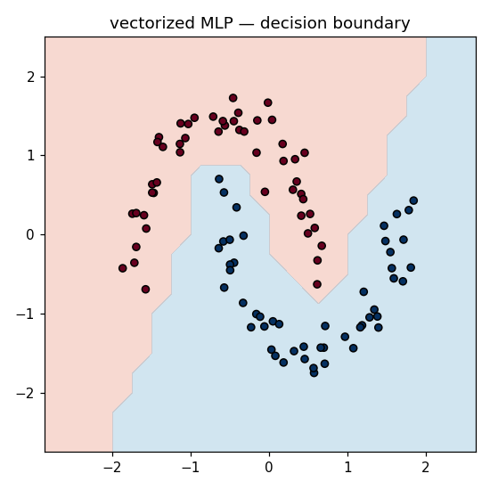

# vectorgrad-from-scratch

A **vectorized** reverse-mode autograd engine (numpy-backed) and a neural-net library on
top of it — where a whole layer is a single matrix multiply. Same autograd ideas as a
scalar engine, but expressed as dense array operations, so it runs ~1000× faster.

Trains an MLP to 100% on two-moons in **~0.04 s** (the scalar version took ~160 s).



## Quickstart

```bash
git clone <your-repo-url> && cd vectorgrad-from-scratch
python -m venv .venv && source .venv/bin/activate   # Windows: .venv\Scripts\activate
pip install -r requirements.txt

pytest -q          # op/gradient-check tests + a learns-the-data test
python train.py    # trains, prints timing, saves boundary.png
```

## What's inside

| path | what it is |
|------|------------|
| `vectorgrad/engine.py` | the `Tensor` autograd core — array ops + broadcasting/matmul backward |
| `vectorgrad/nn.py`     | `Linear` (one matmul) and `MLP` |
| `train.py`             | vectorized training + timing + decision boundary |
| `tests/`               | finite-difference gradient checks for matmul & broadcasting, plus a learns-moons test |
| `GUIDE.md`             | **the step-by-step build guide — start here** |
| `SOLUTION/`            | reference implementation (peek only if stuck) |

## The point

The math is identical to a scalar autograd engine; what changes is the *representation*.
A linear layer `y = x @ W + b` is one BLAS call instead of thousands of Python objects,
and the gradients are the matrix-calculus identities made literal:
`dX = dZ @ Wᵀ`, `dW = Xᵀ @ dZ`. This is why modern ML is fast — the whole field rides on
expressing computation as large matrix operations that hardware runs at full speed.

## License

MIT — see [LICENSE](LICENSE). Design lineage: Karpathy's micrograd, vectorized.
